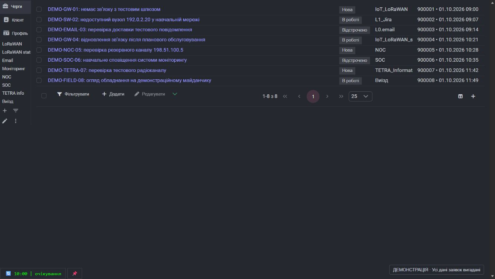
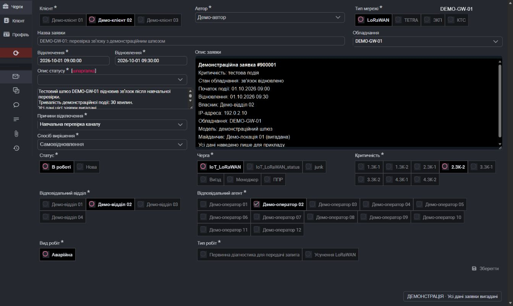
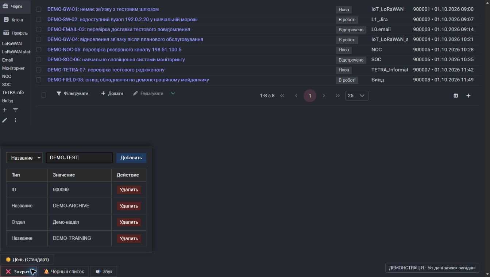
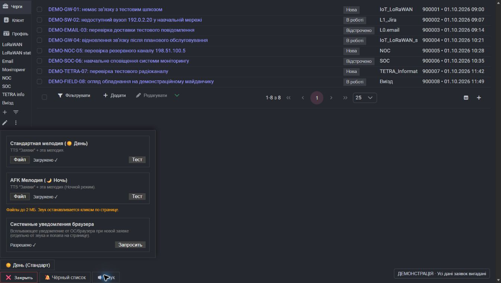

# О sd.bitech

Користувацький скрипт для [sd.bitech.com.ua](https://sd.bitech.com.ua/), який робить роботу із заявками зручнішою: ущільнює список, додає ярлики в бічну панель, стежить за новими заявками та повідомляє про них звуком, повідомленням на сторінці й системним сповіщенням.

Для повного оформлення інтерфейсу встановіть також супровідний стиль. Скрипт додає функції та змінює елементи сторінки, а стиль відповідає за її оформлення.

## Скріншоти

Дані заявок і значення правил на знімках замінено вигаданими прикладами. Кожен скріншот позначено як демонстраційний.

### Список заявок

Компактний список, ярлики черг і дій у бічній панелі, номери заявок та дати створення.

### Сторінка заявки

Приклад картки заявки з вигаданими клієнтами, автором, обладнанням, датами, описом та відповідальними агентами.

### Чорний список

Приклади правил фільтрації за ID, назвою заявки та відділом.

### Звук і сповіщення

Налаштування мелодій для денного та нічного режимів і системних сповіщень браузера.

## Посилання

| Що потрібно | Посилання |
| --- | --- |
| Установити скрипт | [О sd.bitech — актуальна версія](https://github.com/Ovolsan/O-sd.bitech/raw/refs/heads/main/O%20sd.bitech.user.js) |
| Установити стиль | [Стиль для sd.bitech на UserStyles.world](https://userstyles.world/style/27682) |
| Розширення для скрипта | [Tampermonkey](https://www.tampermonkey.net/) |
| Розширення для стилю | [Stylus](https://add0n.com/stylus.html) |
| Відкрити черги | [Мої черги](https://sd.bitech.com.ua/admin/requests?presetId=my-queues) |
| Переглянути код | [Репозиторій на GitHub](https://github.com/Ovolsan/O-sd.bitech) |
| Повідомити про проблему | [Звернення на GitHub](https://github.com/Ovolsan/O-sd.bitech/issues) |

## Можливості

### Інтерфейс і навігація

* Компактний список заявок зі скоригованою шириною колонок статусу та черги.
* Автоматичний вибір 100 заявок на сторінці в усіх списках, зокрема після переходу між чергами.
* Номер заявки, дата й час створення в колонці агентів; список агентів доступний у підказці при наведенні.
* Скорочення довгих назв заявок із відображенням повної назви в підказці.
* Ярлики черг у бічній панелі, скорочені назви та позначення активної черги.
* Швидкий доступ до фільтрування, додавання, редагування та інших дій, доступних на поточній сторінці.
* Пункт «Черги» в основному меню з переходом до «Моїх черг».
* Кнопка виходу залишається доступною на сторінці профілю.
* Заміна відображуваного підпису статусу «Первинна обробка» на власний короткий підпис.
* Налаштування сторінки заявки: порядок блоків, приховування блоків, їхніх назв і окремих варіантів; незаповнені поля підсвічуються трохи темніше.
* Стиль без заокруглень: варіанти без позначок і рамок, вибраний виділяється фоном `#141635`; текст «Назва заявки» на 2px більший.

### Моніторинг і сповіщення

* Виявлення нових заявок за їхніми номерами на сторінці «Мої черги».
* Автоматичне оновлення за таймером із початковим відліком 10 хвилин.
* Призупинення відліку під час роботи зі сторінкою.
* Одна вкладка моніторингу серед кількох відкритих вкладок та можливість обрати її вручну.
* Голосове повідомлення обраною мовою про нові заявки; окрема фраза для першої критичності.
* Власні мелодії для денного та нічного режимів.
* Повідомлення на сторінці, миготіння заголовка вкладки та лічильник нових заявок.
* Системні сповіщення браузера з кількістю заявок і їхньою критичністю.
* Приховування заявок і вимкнення сповіщень про них за назвою, відділом або номером; окремий перемикач для кожного фільтра.
* Українська та російська мови меню, підказок і сповіщень; українська вибрана за замовчуванням.
* Збереження фільтрів, мелодій, мови та обраного режиму в браузері.

## Що потрібно для встановлення

* Сучасний настільний браузер із підтримкою Tampermonkey та Stylus.
* Установлений Tampermonkey для запуску скрипта.
* Установлений Stylus для застосування супровідного стилю.
* Доступ до sd.bitech.com.ua та вхід у власний обліковий запис.

## Установлення скрипта

1. Відкрийте [офіційний сайт Tampermonkey](https://www.tampermonkey.net/), виберіть свій браузер і встановіть розширення.
2. У Chrome та інших браузерах на його основі дозвольте виконання користувацьких скриптів у налаштуваннях Tampermonkey. У Chrome 138 і новіших версіях це перемикач дозволу користувацьких скриптів; якщо він недоступний, використайте режим розробника відповідно до [офіційної інструкції Tampermonkey](https://www.tampermonkey.net/faq.php?locale=en&q=Q209).
3. Перейдіть за посиланням [установлення О sd.bitech](https://github.com/Ovolsan/O-sd.bitech/raw/refs/heads/main/O%20sd.bitech.user.js).
4. У вікні Tampermonkey підтвердьте встановлення та переконайтеся, що скрипт увімкнений.
5. Відкрийте або оновіть сторінку [sd.bitech.com.ua](https://sd.bitech.com.ua/).

Якщо замість вікна встановлення відкрився текст коду, створіть новий скрипт у панелі Tampermonkey, замініть шаблон повним вмістом [основного файла](https://github.com/Ovolsan/O-sd.bitech/blob/main/O%20sd.bitech.user.js), включно з початковим блоком метаданих, і збережіть його.

Для щоденної роботи використовуйте `O sd.bitech.user.js`. Якщо встановлена стара версія або окремий тестовий скрипт сповіщень, вимкніть їх перед запуском актуальної версії.

## Установлення стилю

1. Установіть [Stylus](https://add0n.com/stylus.html) для свого браузера.
2. Відкрийте [сторінку стилю для sd.bitech](https://userstyles.world/style/27682).
3. Натисніть кнопку встановлення стилю та підтвердьте дію у Stylus.
4. Переконайтеся, що стиль увімкнений, і оновіть сторінку sd.bitech.com.ua.

Стиль установлюється окремо від скрипта. Інструкція з роботи з файлами стилів доступна в [документації Stylus](https://github.com/openstyles/stylus/wiki/Usercss).

## Початок роботи

1. Увійдіть у sd.bitech.com.ua та відкрийте [«Мої черги»](https://sd.bitech.com.ua/admin/requests?presetId=my-queues).
2. Знайдіть кнопку таймера з очима в нижньому лівому куті. Наведіть курсор: підказка показує залишок часу, паузу та роль вкладки; поруч розкриваються кнопки меню.
3. Під час наведення на очі з’являється сонце або місяць; натискання перемикає денний і нічний режими. Кнопка фільтрів відкриває правила, а шестерня — налаштування звуку та мови.
4. За потреби завантажте мелодії, перевірте їх відтворення й дозвольте системні сповіщення.
5. Закрийте меню кнопкою активного розділу з хрестиком або клавішею Escape. Кнопки також доступні з клавіатури; при фокусі на очах з’являється перемикач режиму.

Під час першої перевірки скрипт запам'ятовує вже наявні заявки. Сповіщення з'являються, коли наступна перевірка знаходить раніше невідомі номери.

### Таймер і вкладки

Відлік починається з 10 хвилин. Рух миші, натискання клавіш, кліки та прокручування призупиняють його; відлік відновлюється після 10 секунд без цих дій. Після активності з кліками або переходу з вкладки додається 40 секунд, але залишок часу обмежений 10 хвилинами.

Коли час спливає, вкладка моніторингу оновлює основну сторінку «Мої черги» або переходить на неї з іншої сторінки. На цій вкладці таймер зберігається під час переходів, зокрема до створення заявки. Для тривалої роботи з формами зручно залишити окрему вкладку для моніторингу.

Моніторинг виконує одна вкладка в межах того самого браузерного профілю та адреси сайту. Інші показують стан «очікування». Щоб передати моніторинг іншій вкладці, відкрийте на ній «Мої черги» та натисніть 📌. Після закриття вкладки моніторингу інша відкрита вкладка з «Моїми чергами» може автоматично перебрати її роль.

Перевірка порівнює заявки, відображені на поточній сторінці списку, один раз після завантаження документа. Локальна історія містить до 1000 останніх відомих номерів. Раніше не показана заявка також може бути визначена як нова, коли вперше з'явиться у списку.

### Звук і нічний режим

1. Наведіть курсор на таймер та натисніть кнопку з шестернею, щоб відкрити налаштування звуку.
2. Виберіть аудіофайл для денного режиму та, за потреби, окремий файл для нічного режиму з позначкою 🌙.
3. Використовуйте файли до 2 МБ у форматі, який відтворює ваш браузер.
4. Натисніть кнопку перевірки біля кожної мелодії.
5. Перемикайте денний і нічний режими натисканням на очі таймера: при наведенні вони показують сонце або місяць, як у Notifications APC 204.

Режим перемикається вручну й визначає мелодію сповіщення. Спочатку звучить голосове повідомлення «заявки» обраною мовою, а потім вибраний аудіофайл. Для заявки з критичністю `1. ЗК-1` використовується фраза «заявки перша критичність». Без завантаженої мелодії використовується голосове повідомлення, якщо браузер підтримує синтез мовлення.

Клік по сторінці зупиняє поточний звук, прибирає повідомлення, скидає лічильник нових заявок та припиняє миготіння заголовка вкладки.

### Мова інтерфейсу

Відкрийте шестерню та виберіть «Українська» або «Русский» у розділі «Мова інтерфейсу / Язык интерфейса». Вибір застосовується одразу, зберігається після перезавантаження й синхронізується між вкладками сайту. Перекладаються меню, фільтри, підказки, сповіщення та голосова фраза; тексти самих заявок залишаються даними сайту.

Механізм перенесено з Notifications APC 204: переклади з файлів `languages/uk.json` і `languages/ru.json` завантажуються з репозиторію, перевіряються та кешуються локально. Вбудовані переклади доступні одразу й працюють без мережі, зокрема до публікації нових мовних файлів. Запізнілий результат завантаження не перемикає обрану мову.

### Системні сповіщення

У налаштуваннях звуку знайдіть розділ системних сповіщень, натисніть кнопку запиту дозволу та дозвольте сповіщення для sd.bitech.com.ua у браузері.

Сповіщення містить кількість нових заявок і їхню критичність. Натискання на нього повертає фокус до вкладки браузера. Якщо дозвіл раніше заблоковано, змініть його в налаштуваннях сайту та оновіть сторінку.

### Фільтри заявок

Натисніть кнопку фільтрів поруч із таймером. Виберіть тип, введіть значення та додайте правило.

| Тип фільтра | Як працює | Приклад |
| --- | --- | --- |
| Назва | Шукає фрагмент у назві без урахування регістру | `тест` приховає назви, що містять це слово |
| Відділ | Шукає фрагмент у назві відділу без урахування регістру | Укажіть назву або частину назви потрібного відділу |
| Номер заявки | Шукає точний збіг; значення має містити тільки цифри | `12345` застосовується лише до заявки №12345 |

Достатньо збігу з будь-яким увімкненим правилом: заявка приховується зі списку, а сповіщення про неї пропускаються. Це змінює відображення у вашому браузері; сама заявка зберігається в системі. Перемикач у першій колонці вимикає правило без видалення; повторне натискання вмикає його. Список заявок змінюється одразу. Стан перемикачів зберігається після перезавантаження та оновлюється в інших відкритих вкладках цього браузера. Наявні правила без збереженого стану вважаються увімкненими.

### Блоки сторінки заявки

Кнопка «Зберегти» перенесена в ліве меню заявки під «Історія»: велика іконка, назва — у підказці при наведенні. Натисніть на неї правою кнопкою миші й виберіть «Налаштувати блоки заявки». Над формою з'явиться підказка, а кожен блок отримає панель:

| Елемент | Дія |
| --- | --- |
| ⠿ | Перенести блок у колонку під курсором; синя лінія показує, між якими блоками він стане |
| Правий / нижній край, кут | Змінити ширину (у колонках) / мінімальну висоту / обидва розміри |
| ‹ › | Перенести блок у сусідню колонку |
| ˄ ˅ | Поміняти блок місцями із сусідом вище або нижче в колонці |
| 📌 | Закріпити ряд: блок і ті, що зараз стоять поруч у інших колонках, завжди стоять на одній лінії й не з'їжджають |
| 👁 | Сховати або показати блок |
| Aa | Сховати або показати назви блоку; прихована назва з'являється в підказці при наведенні |
| ☰ | Сховати окреме поле або його назву, якщо в блоці їх кілька (є лише в таких блоках) |

Блоки в кожній колонці йдуть щільно один за одним: висота блоку береться з його вмісту, тому пустот між рядками немає. Коли блок прихований або його немає в цій заявці (наприклад, «Дата й час SLA» буває лише при статусі «Відстрочено»), блоки нижче піднімаються на його місце, а коли він з'являється — знову звільняють його. Широкий блок (на дві-три колонки) стає під найнижчим блоком цих колонок.

Закріплений ряд починається нижче за все, що стоїть над ним, тож пара блоків тримається разом, навіть коли блоки вище з'являються, зникають або змінюють висоту. Наприклад, закріпіть «Відповідальний відділ», коли «Відповідальний агент» стоїть поруч, і «Вид робіт» поруч із «Тип робіт».

Висоту текстового поля (наприклад, «Опис статусу») задайте в режиме налаштування його правим нижнім кутом — вона запам'ятається як мінімальна.

Сайт іноді кладе кілька полів в одну комірку: наприклад, «Опис заявки» і «Первинна діагностика» або «Відключення», «Опис статусу» й «Причини відключення». Кнопка ☰ відкриває список полів блоку, і кожне можна сховати окремо, не чіпаючи сусідів.

У режимі налаштування клік по назві поля ховає лише її, і вона одразу зникає, як після збереження (повернути — «Aa» на панелі блоку або в меню ☰), а клік по варіанту (наприклад, «ЗКП» у «Тип мережі» чи агенту у «Відповідальний агент») ховає цей варіант. Приховане показується перекресленим, тож його можна повернути тим самим кліком. Вибраний варіант лишається видимим, навіть якщо його приховано. Поки режим увімкнений, клік не змінює саму заявку. Завершити — «Готово», Esc або той самий пункт контекстного меню. «Скинути» повертає розташування сайту.

Блоки впізнаються за полями, а не за місцем на сторінці, тому розташування зберігається, коли розробники сайту переставляють поля. Розкладка запам'ятовується окремо для 3, 2 та 1 колонки (сайт перемикає їх за шириною вікна); для ширини, яку ще не налаштовували, блоки йдуть у тому самому порядку по сітці сайту.

## Збереження налаштувань

Фільтри, налаштування блоків заявки, завантажені мелодії, мова, режим звуку та історія відомих заявок зберігаються локально для адреси сайту у вашому браузерному профілі. Очищення даних сайту видаляє ці налаштування. На іншому пристрої або в іншому профілі їх потрібно налаштувати окремо.

## Оновлення та вимкнення

Джерело оновлень скрипта задане в його метаданих і веде до основного файла в гілці `main`. Скористайтеся перевіркою оновлень у Tampermonkey або повторно відкрийте [посилання встановлення](https://github.com/Ovolsan/O-sd.bitech/raw/refs/heads/main/O%20sd.bitech.user.js) для перевстановлення актуального коду. Оновлення стилю перевіряються окремо через Stylus.

Щоб тимчасово вимкнути зміни, вимкніть скрипт у Tampermonkey та стиль у Stylus, після чого оновіть сторінку. Для видалення скористайтеся панелями керування цих розширень.

## Якщо щось не працює

| Ситуація | Що перевірити |
| --- | --- |
| Інтерфейс не змінився | Чи ввімкнені Tampermonkey, скрипт і Stylus; чи встановлено стиль; чи відкрито саме sd.bitech.com.ua. Після встановлення оновіть сторінку. |
| Скрипт не запускається в Chrome або Edge | Дозвіл виконання користувацьких скриптів і доступ розширення до сайту. Дивіться [інструкцію Tampermonkey](https://www.tampermonkey.net/faq.php?locale=en&q=Q209). |
| Панелі моніторингу немає | Відкрийте «Мої черги» за посиланням вище. Панель зазвичай прихована на інших сторінках. |
| Вкладка показує «очікування» | Моніторинг виконує інша вкладка. Для передачі ролі натисніть 📌 на сторінці «Мої черги». |
| Таймер стоїть на місці | Активність користувача призупиняє відлік. Залиште сторінку без взаємодії щонайменше на 10 секунд. |
| Немає звуку | Натисніть перевірку мелодії, перевірте гучність, вибраний режим, аудіофайл та дозвіл браузера на відтворення звуку. |
| Немає системних сповіщень | Перевірте дозвіл сайту на сповіщення, налаштування сповіщень браузера в операційній системі та режим «Не турбувати». |
| Заявка зникла зі списку | Перегляньте правила фільтрів і видаліть правило, що збігається з нею. |
| Немає сповіщення про наявну заявку | Перша перевірка запам'ятовує список. Подальші перевірки повідомляють про невідомі номери, які не підпадають під фільтри. |

Якщо проблема залишається, створіть [звернення в репозиторії](https://github.com/Ovolsan/O-sd.bitech/issues) та вкажіть браузер, його версію, версію скрипта й кроки відтворення.

## Файли репозиторію

* [`O sd.bitech.user.js`](https://github.com/Ovolsan/O-sd.bitech/blob/main/O%20sd.bitech.user.js) — основний скрипт для встановлення.
* [`O sd.bitechOLD.user.js`](https://github.com/Ovolsan/O-sd.bitech/blob/main/O%20sd.bitechOLD.user.js) — попередня версія.
* [`Тест системных уведомлений.js`](https://github.com/Ovolsan/O-sd.bitech/blob/main/%D0%A2%D0%B5%D1%81%D1%82%20%D1%81%D0%B8%D1%81%D1%82%D0%B5%D0%BC%D0%BD%D1%8B%D1%85%20%D1%83%D0%B2%D0%B5%D0%B4%D0%BE%D0%BC%D0%BB%D0%B5%D0%BD%D0%B8%D0%B9.js) — допоміжний файл для тестування сповіщень.
* `README.md` — опис проєкту та інструкція користувача.

Автор: [Ovolsan](https://github.com/Ovolsan).
